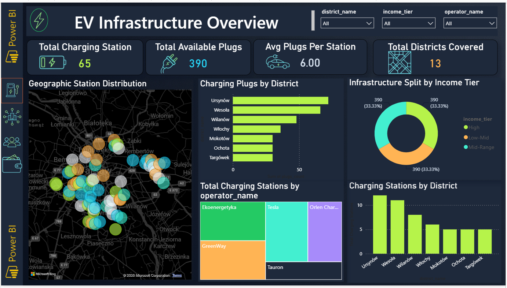
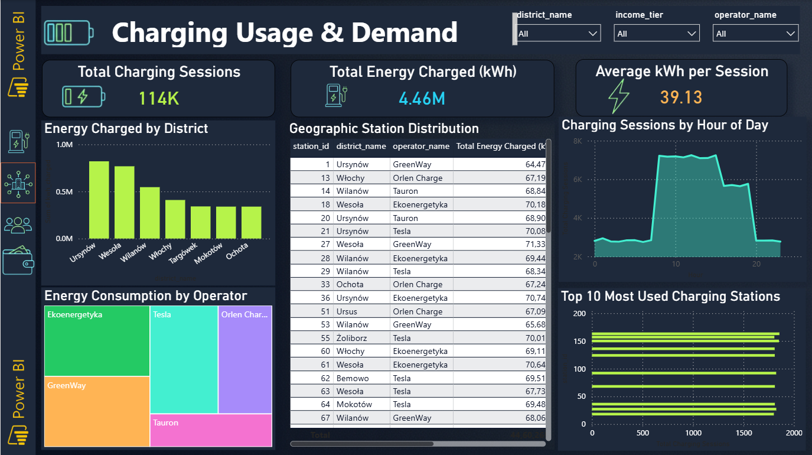
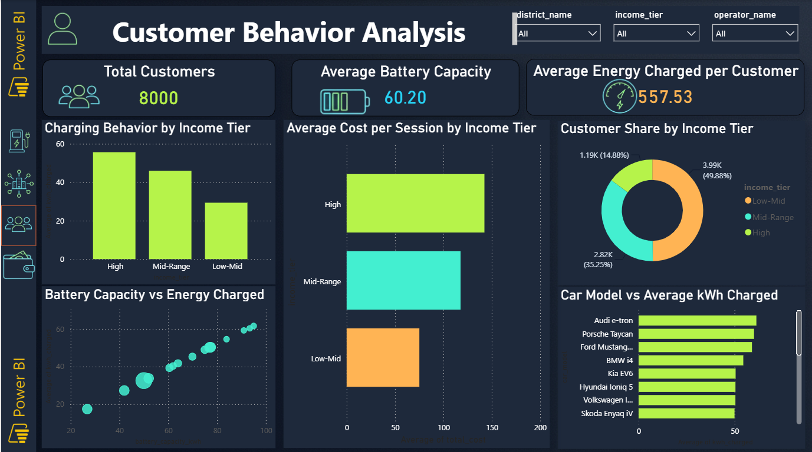
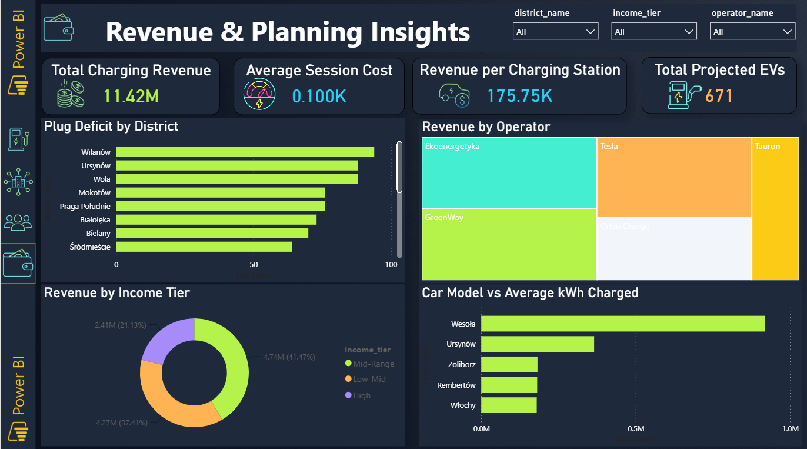

# Warsaw EV Charging Analytics

**Capstone Project | SQL (MySQL) + Power BI**  
Author: Kavita Kanwar Naruka

## Project Overview

This project analyses EV charging infrastructure across Warsaw districts from the perspective of a Data Analyst on the city's EV Infrastructure Team. It evaluates charging station usage, customer charging behaviour across income tiers, and whether current infrastructure supports projected EV growth, to support data-driven expansion planning.

## Objectives

- Identify high-demand charging locations
- Assess whether current infrastructure supports projected EV growth
- Understand charging behaviour across income tiers
- Support data-driven EV infrastructure expansion planning

## Tools & Technologies

| Tool | Purpose |
|---|---|
| MySQL | Database design and SQL analysis |
| Power BI | Interactive 4-page dashboard |
| PowerPoint | Project presentation |

## Dataset

Four source tables, loaded into a MySQL database (`warsaw_ev_db`):

| Table | Description |
|---|---|
| `districts` | District name, income tier, projected EVs, projected plugs, projected regular customers |
| `charging_stations` | Station ID, district, income tier, operator, plug count, latitude/longitude |
| `charging_sessions` | Session ID, customer, station, start time, kWh charged, cost per kWh, total cost |
| `customers` | Customer ID, income tier, car model, battery capacity (kWh) |

## Project Workflow

1. Created the `warsaw_ev_db` database and four related tables with primary and foreign keys
2. Wrote 14 SQL queries (basic, intermediate, advanced) to answer the business questions
3. Built a 4-page Power BI dashboard with slicers for district, income tier and operator
4. Summarised the SQL analysis and dashboard in a project presentation

## SQL Analysis

All 14 queries are in [`Warsaw_EV_Charging.sql`](Warsaw_EV_Charging.sql).

| Level | Analysis |
|---|---|
| Basic | Districts and income tiers; stations per district; plugs per district; total sessions; average kWh per session |
| Intermediate | Total kWh by district; top 5 stations by sessions; revenue by district; average session cost by income tier; average kWh per customer |
| Advanced | Projected EVs vs available plugs; districts where projected EVs exceed plugs; kWh demand per projected EV; district infrastructure readiness ranking |

Query results are in the presentation: [`Warsaw_EV_Charging_Analytics.pptx`](Warsaw_EV_Charging_Analytics.pptx).

## Power BI Dashboard

The dashboard has four pages. Each page has slicers for `district_name`, `income_tier` and `operator_name`.

**Power BI File:** [Download Warsaw EV Charging.pbix](Warsaw%20EV%20Charging.pbix)

### 1. EV Infrastructure Overview

KPIs: 65 charging stations, 390 plugs, 6.00 average plugs per station, 13 districts covered. Visuals cover station map, plugs by district, stations by district and stations by operator.



### 2. Charging Usage & Demand

KPIs: 114K charging sessions, 4.46M kWh charged, 39.13 kWh average per session. Visuals cover energy by district, energy by operator, sessions by hour of day and most-used stations.



### 3. Customer Behavior Analysis

KPIs: 8,000 customers, 60.20 average battery capacity, 557.53 average energy charged per customer. Visuals cover income-tier behaviour, cost per session by tier, customer share by tier, battery capacity vs energy charged and car model vs average kWh.



### 4. Revenue & Planning Insights

KPIs: 11.42M total charging revenue, an average session cost of about 100, 175.75K revenue per charging station. Visuals cover plug deficit by district, revenue by operator and revenue by income tier.



## Key Insights

Based on the dashboard:

- Ursynów and Wesoła have the most stations and the highest energy charged by district
- Charging sessions peak during daytime hours (roughly 08:00 to 15:00) and are lowest overnight
- High income-tier customers have the highest average cost per session, followed by Mid-Range and Low-Mid
- The plug deficit chart shows Wilanów, Ursynów and Wola with the largest gaps between projected EVs and available plugs

## Repository Structure

```text
├── README.md
├── Warsaw_EV_Charging.sql
├── Warsaw_EV_Charging_Analytics.pptx
├── Warsaw EV Charging.pbix
└── images/
    └── powerbi/
        ├── 01_ev_infrastructure_overview.png
        ├── 02_charging_usage_demand.png
        ├── 03_customer_behavior_analysis.png
        └── 04_revenue_planning_insights.png
```
